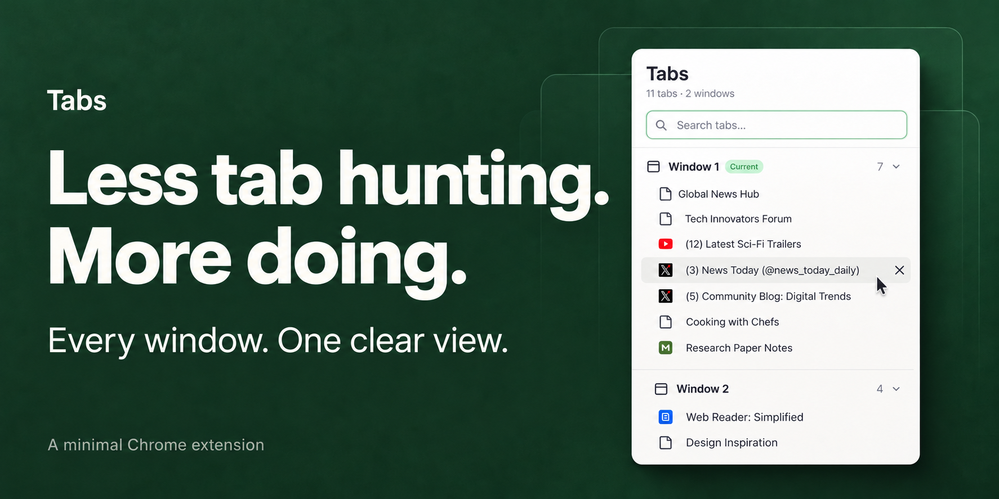
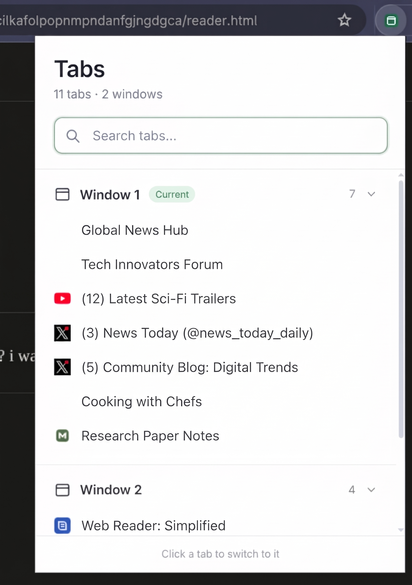

# Tabs

**Every window. One clear view.**

Find the tab you need, switch straight to it, and close the ones you’re done with. Tabs brings your open Chrome windows into one simple, searchable popup.

[Install in Chrome](#install) · [See the app](#see-the-app) · [Privacy](#privacy)

## See the app

<p align="center">
  
</p>

Search across windows. Jump to the right page. Clear the clutter without losing your place.

## Features

- Open tabs grouped by browser window, with favicons and titles.
- Search by title or URL.
- Click a tab to switch to it and focus its window.
- Drag a tab onto another window group to move it there, including collapsed windows.
- Or use a row’s **Move tab** button, then click the destination window heading. Press **Escape** to cancel.
- Hover or keyboard-focus a row to reveal its close button.
- Close tabs without losing your scroll position.
- Collapse window sections and identify the current window.
- Live updates when tabs open, close, move, or change title.

## Install

1. Download this repository using **Code → Download ZIP**, then extract it, or clone it:
   
   ```sh
   git clone https://github.com/nickdc8/tab-manager.git
   ```
2. Open `chrome://extensions` in Chrome.
3. Enable **Developer mode**.
4. Click **Load unpacked** and select the `tab-manager` folder containing `manifest.json`.
5. Pin **Tabs** from Chrome's extensions menu, then click its toolbar icon.

No dependencies or build step. Keep the folder in place after loading it. After pulling updates, click **Reload** on the extension at `chrome://extensions`.

## Keyboard controls

Use **Tab** to move between controls and **Enter** or **Space** to activate a button. In the search field, **Arrow Down** focuses the first matching tab and **Escape** clears the search.

Moved tabs go to the end of the destination window; pinned tabs stay in its pinned section. Moving the final tab out of a window closes that window.

Search temporarily expands matching window sections. Closing a window's final tab also closes that window. Only normal browser windows are listed; incognito access follows Chrome's extension settings.

## Privacy

The `tabs` permission reads tab titles and URLs. The `favicon` permission displays Chrome's cached favicons. Tab data stays in popup memory; there are no analytics, external services, remote scripts, or background processes.

See [Chrome's favicon documentation](https://developer.chrome.com/docs/extensions/how-to/ui/favicons).

## Local preview

Open `popup.html` in a browser to explore the UI with sample tabs. Preview close buttons only remove sample rows.

## Checks

Run the popup interaction checks with Node.js:

```sh
node --test tests/popup.test.cjs
```

These use a mocked DOM and Chrome API; they do not replace testing the unpacked extension in Chrome. Tab moves use [Chrome’s tabs.move API](https://developer.chrome.com/docs/extensions/reference/api/tabs#method-move).
